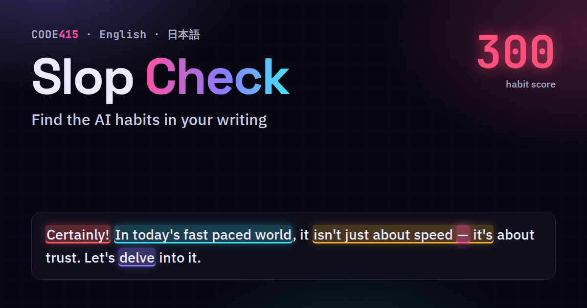

# Slop Check

Find the AI writing habits in your text. Paste a post, an email or an essay and the habits chatbots lean on light up: pet words like *delve*, stock phrases like *it's worth noting*, sentence tricks like *It's not X, it's Y*, em dashes, and chatbot leftovers like *I hope this helps*. English and 日本語.

**Try it:** https://code415.dev/demos/2026-10-20/slop-check



Everything runs in your browser. Your text is not sent or stored anywhere. No dependencies, one JavaScript file.

## A habit is not proof

Plenty of people write like this, especially in school essays, business email and translated text, and good writers use an em dash on purpose. Please don't use this to accuse anyone of using AI. Use it on your own drafts.

## Use it

**In the browser.** Open the page above, or `docs/index.html` from this repo. Click a habit in the list to see where it is. *Swap the easy ones* replaces words that have a plain equivalent and removes filler. It never rewrites your sentences, so read the result before you post it.

**From the command line.** Node 14 or newer, nothing to install:

```sh
npx github:guoziyu415/slop-check draft.md
cat post.txt | npx github:guoziyu415/slop-check
npx github:guoziyu415/slop-check --max 40 docs/*.md   # exit 1 if a file scores above 40, handy in CI
npx github:guoziyu415/slop-check --fix draft.md      # print the text with the easy swaps
npx github:guoziyu415/slop-check --json draft.md
```

Or clone and run `node cli.js draft.md`.

```
draft.md  score 130 per 1,000 words  Chatbot voice  (5 habits, 15 words)
  1:1     Certainly!                   Certainly!
  1:12    In today's fast paced world  In today's fast-paced world
  1:40    Em dash                      —
  1:45    delve                        delve
  2:1     It's not X, it's Y           It's not a tool. It's
```

**As a library.**

```js
const SlopCheck = require("./slop-check.js");   // or a <script> tag, then window.SlopCheck
const r = SlopCheck.analyze("Certainly! Let's delve into it.");
r.score        // weighted habits per 1,000 words
r.band.en      // "Reads human", "A few tells", "Lots of tells" or "Chatbot voice"
r.hits         // [{ s, e, id, cat, w }] character ranges
r.byPattern    // grouped, with why and what to try instead
SlopCheck.fix("We should leverage this.").text   // "We should use this."
```

## How the score works

- It looks for 91 English and 51 Japanese habits that show up far more in chatbot text than in ordinary writing. The full list with weights is in [PATTERNS.md](PATTERNS.md).
- Each habit has a weight. Em dashes, sentence tricks and chatbot leftovers count most, single pet words count least.
- The score is the weighted count per 1,000 words, or per 2,000 Japanese characters. Short texts count as at least 100 words or 200 characters, so one dash in a tweet does not look like a disaster.
- Under 15 usually reads human, 15 to 40 has a few tells, 40 to 80 has lots, over 80 reads like it came straight out of a chat window.

## Where this came from

On October 19, 2026 Erik Markus Kannike shared [qwen3-4b-deslop](https://100toolkit.com/blog/deslop-model/), a small LoRA on Qwen3-4B trained for 1 to 3 hours on an M2 MacBook Air, plus a sign flip on four neurons. On 40 held out prompts his habit score fell from 121 to 12.5 per 1,000 words and em dashes from 20.5 to 0, while it still answered 30 of 30 quiz questions. His pattern list is not published, so his numbers and the scores here are not on the same scale. Same idea, our own list.

I found it on [Code415 Radar](https://code415.dev/d/2026-10-20#2026-10-20-03), got curious, and built this with Claude to learn what these habits actually are.

## 日本語

文章を貼ると、チャットボットがよく使う言い回しが光ります。「いかがでしたか」「〜と言えるでしょう」「〜することが大切です」「もちろんです！」、太字とコロンの箇条書き、ダッシュなど51種類。日本語は2,000字あたりで数えます。出典は [PATTERNS.md](PATTERNS.md) にあります。癖があってもAIの証拠ではありません。自分の下書きの見直しに使ってください。

## License

MIT. Made by Ziyu Guo, [@Code415zg](https://x.com/Code415zg), [code415.dev](https://code415.dev).
